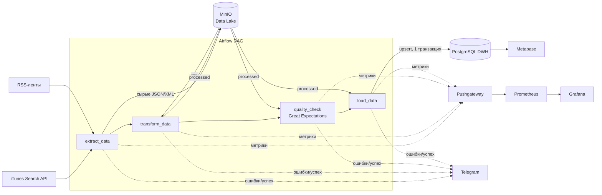

# Podcast Data ETL Pipeline

ETL-конвейер для сбора, обработки и загрузки данных о подкастах и их выпусках из Apple iTunes Search API и RSS-лент в хранилище PostgreSQL. Курсовой проект по дисциплине «Инжиниринг данных».

**Цель:** автоматизировать сбор и подготовку данных о подкастах для анализа публикационной активности, длительности выпусков и качества источников.

## Архитектура



Между задачами Airflow передаются только ключи объектов в MinIO (XCom остаётся маленьким), данные лежат в слоях `raw/`, `processed/`, `quality/`.

## Быстрый старт

```bash
cp .env.example .env          # 1. параметры стенда
docker compose up -d --build  # 2. весь стенд одной командой
```

Откройте Airflow, включите DAG `podcast_etl_pipeline` и запустите его (`Trigger DAG`; можно «w/ config»: `search_term`, `limit`, `load_mode`).

| Сервис | URL | Доступ |
|---|---|---|
| Airflow | http://localhost:8080 | `AIRFLOW_ADMIN_USER` / `AIRFLOW_ADMIN_PASSWORD` из `.env` (по умолчанию admin/admin) |
| MinIO (консоль) | http://localhost:9001 | `MINIO_ROOT_USER` / `MINIO_ROOT_PASSWORD` |
| Grafana | http://localhost:3001 | admin/admin, дашборд «Podcast ETL — состояние конвейера» |
| Prometheus | http://localhost:9090 | — |
| Metabase | http://localhost:3000 | настраивается при первом входе; подключите БД `podcast_dwh`, используйте представления `v_*` |
| PostgreSQL | localhost:5432 | `POSTGRES_USER` / `POSTGRES_PASSWORD` |

> Скрипты `sql/` выполняются только при первом старте с пустым томом. Для изменения существующей схемы используйте миграции, не удаляя тома с данными.

## Структура проекта

```
podcast-etl/
├── dags/podcast_etl_dag.py        # оркестрация (тонкий слой над src/pipeline.py)
├── src/
│   ├── config.py                  # параметры из окружения
│   ├── extract.py                 # iTunes + RSS, retry, лимиты, defusedxml
│   ├── transform.py               # очистка, нормализация, обогащение, агрегация
│   ├── quality.py                 # проверки Great Expectations
│   ├── load.py                    # идемпотентная пакетная загрузка, инкремент
│   ├── storage.py                 # MinIO (Data Lake)
│   ├── metrics.py                 # метрики → Pushgateway
│   ├── notifications.py           # Telegram-уведомления
│   ├── pipeline.py                # стадии extract/transform/quality/load
│   └── frames.py, exceptions.py
├── sql/                           # 00_create_databases.sh, init.sql (схема + представления)
├── monitoring/                    # prometheus.yml, provisioning и дашборд Grafana
├── docker/Dockerfile              # Airflow 2.7.3, Python 3.10
├── tests/                         # unit/, integration/, system/, test_dag_integrity.py
├── docker-compose.yml, requirements.txt, pytest.ini, .env.example
```

## Модель данных

`podcasts` (метаданные) · `episodes` (выпуски; уникальный `episode_key` = sha1(podcast_id, guid/title, pub_date)) · `podcast_stats` (агрегаты) · представления `v_kpi`, `v_top_podcasts`, `v_monthly_publications`, `v_duration_distribution`, `v_activity_matrix` (метрики и срезы для Metabase).

## Трассировка требований методички

| Требование | Реализация |
|---|---|
| Python 3.10+ | `docker/Dockerfile`: `apache/airflow:2.7.3-python3.10` |
| Airflow 2.7+, DAG, расписание, зависимости (FR-4.1, 4.3) | `dags/podcast_etl_dag.py`: `@daily`, цепочка из 4 задач, `max_active_runs=1` |
| Ручной запуск (FR-4.2) | Trigger DAG, параметры `search_term`, `limit`, `load_mode` |
| Уведомления об успехе/ошибке | `notifications.py`: `on_failure_callback` (после исчерпания retries), `on_success_callback` DAG |
| Extract: API + RSS, ошибки, retry | `extract.py`: `Retry` с exponential backoff, таймауты, лимит размера, параллельная загрузка лент; недоступность iTunes → исключение → retry Airflow |
| Сырые данные в Data Lake (FR-3.1) | `storage.py` + MinIO: `raw/itunes/…`, `raw/rss/…` |
| Очистка, типы, дедупликация (FR-2.1, 2.2, 2.4) | `transform.py`: очистка HTML, даты → UTC, длительность → секунды, дедупликация по `episode_key` |
| Агрегация и обогащение (FR-2.3) | обогащение: `duration_bucket`, `pub_month`, язык/описание из RSS; агрегация: `podcast_stats` (средняя длительность, выпусков/мес, сегмент активности) |
| Load в PostgreSQL 15 (FR-3.2) | `load.py`: пакетный upsert (`ON CONFLICT`), одна транзакция (откат при сбое) |
| Идемпотентность (NFR-3) | детерминированный `episode_key` (всегда NOT NULL), тесты многократного запуска |
| Инкрементальная/полная загрузка | `LOAD_MODE` / параметр DAG; водяной знак по `MAX(pub_date)` подкаста |
| Great Expectations (FR-5.1–5.3) | `quality.py`: полнота, уникальность, бизнес-правила; critical блокируют загрузку, warning — в отчёт `quality/<ds>/report.json` |
| pytest 7+, тесты Extract/Transform/Load, покрытие ≥ 70% | `tests/`, `pytest.ini`: `--cov=src --cov-fail-under=70` |
| Интеграционные и системные тесты | `tests/integration`, `tests/system` (отказоустойчивость, откат, производительность) |
| Prometheus + Grafana (NFR-9) | Pushgateway → Prometheus → дашборд (статус, длительность, объёмы, DQ, давность успешной загрузки) |
| Docker, запуск одной командой | `docker compose up -d --build` |
| Конфигурация вне кода (NFR-6) | `.env` / переменные окружения |
| Логирование INFO/WARNING/ERROR (NFR-8) | модули `logging` + логи Airflow |
| Автоперезапуск (NFR-5) | `retries=3` с backoff, `restart: unless-stopped`, healthcheck |
| Безопасность (NFR-10) | HTTPS-only для лент (`REQUIRE_TLS`), `defusedxml`, `POSTGRES_SSLMODE`, `MINIO_SECURE`, порты БД/MinIO на 127.0.0.1, секреты в `.env`; внутри docker-сети трафик без TLS (ограничение учебного стенда) |

## Тестирование

```bash
docker compose exec airflow-webserver pytest                       # unit + component + system, с покрытием
docker compose exec airflow-webserver pytest -m system -s --no-cov # производительность и отказоустойчивость
docker compose exec -e POSTGRES_DB=podcast_test_dwh -e RUN_INTEGRATION=1 airflow-webserver \
    pytest tests/integration/test_real_services.py -m integration -s --no-cov   # реальные iTunes/RSS, MinIO, PostgreSQL
```

Для замера NFR-4 (100 000 записей < 5 мин) на PostgreSQL запустите `docker compose exec -e POSTGRES_DB=podcast_test_dwh -e RUN_PG_PERF=1 airflow-webserver pytest tests/system/test_performance.py -m system -s --no-cov`; полученные цифры занесите в пояснительную записку.

## Параметры

См. `.env.example`: источники (`SEARCH_TERM`, `LIMIT`), загрузка (`LOAD_MODE`, `MAX_WORKERS`, `MAX_EPISODES_PER_FEED`), безопасность, Telegram (`TELEGRAM_BOT_TOKEN`, `TELEGRAM_CHAT_ID`).

## Ограничения

- Лимит выпусков на ленту (`MAX_EPISODES_PER_FEED`) ограничивает глубину истории.
- Инкремент определяется по дате публикации; правки старых выпусков подхватываются только в режиме `full`.
- Ленты без HTTPS пропускаются (можно отключить `REQUIRE_TLS=false`).
- NFR-1 (доступность 99,9%) требует наблюдения за реальными запусками и не может быть подтверждён одними тестами.

## Автор

bbsnya
