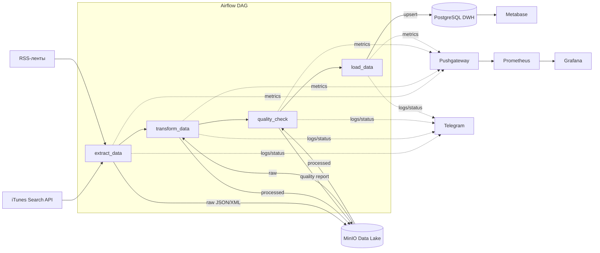

# Podcast Data ETL Pipeline

ETL-конвейер для сбора, обработки и загрузки данных о подкастах и их выпусках из **Apple iTunes Search API** и **RSS-лент** в аналитическое хранилище PostgreSQL.

## Архитектура



Данные хранятся в MinIO в трёх логических слоях:

- `raw/` — исходные ответы API и RSS-данные;
- `processed/` — обработанные и нормализованные наборы данных;
- `quality/` — отчёты о проверках качества.

Между задачами Airflow передаются ссылки на объекты в MinIO, а не большие наборы данных. Это позволяет не перегружать XCom.

## Технологический стек

| Компонент | Технология |
|---|---|
| Язык программирования | Python 3.10 |
| Оркестрация | Apache Airflow 2.7.3 |
| Источник метаданных | Apple iTunes Search API |
| Источник выпусков | RSS |
| Обработка данных | Pandas |
| Проверка качества | Great Expectations |
| Data Lake | MinIO |
| Аналитическое хранилище | PostgreSQL 15 |
| Контейнеризация | Docker Compose |
| Сбор метрик | Prometheus, Pushgateway |
| Мониторинг | Grafana |
| BI и визуализация | Metabase |
| Тестирование | Pytest, pytest-cov |

## Быстрый старт

### Требования

- Docker и Docker Compose;
- Git;
- доступ к интернету для получения данных из iTunes API и RSS-лент.

### Подготовка

Клонируйте репозиторий и перейдите в каталог проекта:

```bash
git clone <URL-репозитория>
cd podcast-etl
```

Создайте файл конфигурации:

```bash
cp .env.example .env
```

Перед запуском заполните `.env`:

- задайте собственные пароли PostgreSQL, MinIO и Grafana;
- задайте пароль администратора Airflow;
- сгенерируйте корректный `AIRFLOW_FERNET_KEY`;
- задайте `AIRFLOW_SECRET_KEY`;
- проверьте параметры подключения и загрузки.

Для генерации Fernet-ключа:

```bash
python -c "from cryptography.fernet import Fernet; print(Fernet.generate_key().decode())"
```

Полученное значение необходимо записать в `AIRFLOW_FERNET_KEY`.

**Важно:** файл `.env` и TLS-сертификаты не следует публиковать в репозитории. Docker Compose использует локальные сертификаты из каталога `certs/`; перед запуском необходимо подготовить их в соответствии с конфигурацией проекта.

### Запуск

```bash
docker compose up -d --build
```

После запуска откройте Airflow, найдите DAG `podcast_etl_pipeline` и выполните `Trigger DAG`.

При ручном запуске можно передать параметры:

- `search_term` — поисковый запрос;
- `limit` — количество результатов поиска;
- `load_mode` — режим загрузки: `incremental` или `full`.

### Доступ к сервисам

| Сервис | Адрес | Учётные данные |
|---|---|---|
| Airflow | http://localhost:8080 | `AIRFLOW_ADMIN_USER` / `AIRFLOW_ADMIN_PASSWORD` |
| MinIO Console | https://localhost:9001 | `MINIO_ROOT_USER` / `MINIO_ROOT_PASSWORD` |
| PostgreSQL | localhost:5432 | `POSTGRES_USER` / `POSTGRES_PASSWORD` |
| Prometheus | http://localhost:9090 | Без авторизации |
| Pushgateway | http://localhost:9091 | Без авторизации |
| Grafana | http://localhost:3001 | `GRAFANA_ADMIN_USER` / `GRAFANA_ADMIN_PASSWORD` |
| Metabase | http://localhost:3000 | Настраивается при первом входе |

Для Grafana и Airflow используются значения из `.env`. Если переменные не заданы, Compose может использовать значения по умолчанию, указанные в `docker-compose.yml`. Для рабочего запуска рекомендуется задать собственные пароли.

В Grafana настроен дашборд **Podcast ETL — состояние конвейера**.

В Metabase после первоначальной настройки подключите аналитическую базу данных `podcast_dwh`. Для построения отчётов доступны представления `v_*`.

> SQL-скрипты инициализации выполняются при первом запуске PostgreSQL с пустым томом. Изменение существующей схемы следует выполнять через миграции. Не удаляйте Docker volumes, если необходимо сохранить данные.

## Структура проекта

```text
podcast-etl/
├── dags/
│   └── podcast_etl_dag.py
├── src/
│   ├── config.py
│   ├── extract.py
│   ├── transform.py
│   ├── quality.py
│   ├── load.py
│   ├── storage.py
│   ├── metrics.py
│   ├── notifications.py
│   ├── pipeline.py
│   ├── frames.py
│   └── exceptions.py
├── sql/
│   ├── 00_create_databases.sh
│   └── init.sql
├── monitoring/
│   ├── prometheus.yml
│   └── grafana/
│       ├── provisioning/
│       └── dashboards/
├── docker/
│   └── Dockerfile
├── tests/
│   ├── unit/
│   ├── integration/
│   ├── system/
│   └── test_dag_integrity.py
├── .env.example
├── .gitignore
├── docker-compose.yml
├── pytest.ini
└── requirements.txt
```

## Этапы ETL-конвейера

### 1. Extract — извлечение

- Поиск подкастов через Apple iTunes Search API.
- Получение RSS-адресов и загрузка выпусков.
- Обработка сетевых ошибок и повторные запросы с экспоненциальной задержкой.
- Ограничение времени ожидания и размера загружаемых данных.
- Параллельная загрузка RSS-лент.
- Сохранение исходных данных в MinIO.

### 2. Transform — преобразование

- Очистка HTML-разметки и текстовых полей.
- Нормализация дат и времени к UTC.
- Приведение длительности выпусков к секундам.
- Удаление дубликатов.
- Формирование уникального ключа `episode_key`.
- Обогащение данных: категории длительности, месяц публикации и другие аналитические признаки.
- Расчёт агрегированных показателей по подкастам.

### 3. Quality — контроль качества

Для проверки данных используется Great Expectations.

Проверки охватывают:

- полноту обязательных полей;
- уникальность идентификаторов;
- корректность URL;
- допустимые диапазоны значений;
- корректность длительности и дат публикации;
- допустимые категории длительности.

Ошибки разделяются на два уровня:

- `critical` — критические нарушения, блокирующие дальнейшую загрузку;
- `warning` — предупреждения, сохраняемые в отчёте.

Результаты проверок сохраняются в MinIO в слое `quality/`.

### 4. Load — загрузка

- Загрузка обработанных данных в PostgreSQL.
- Пакетная запись данных.
- Использование `INSERT ... ON CONFLICT` для обновления существующих записей.
- Выполнение операций в транзакции.
- Поддержка инкрементального и полного режимов загрузки.

## Модель данных

Основные таблицы аналитического хранилища:

| Таблица | Назначение |
|---|---|
| `podcasts` | Метаданные подкастов |
| `episodes` | Информация о выпусках |
| `podcast_stats` | Агрегированные показатели по подкастам |

Для идентификации выпусков используется детерминированный ключ `episode_key`, формируемый на основе идентификатора подкаста и доступных атрибутов выпуска.

Для аналитики предусмотрены представления:

- `v_kpi` — основные показатели;
- `v_top_podcasts` — рейтинги подкастов;
- `v_monthly_publications` — динамика публикаций;
- `v_duration_distribution` — распределение длительности выпусков;
- `v_activity_matrix` — матрица активности.

## Оркестрация и надёжность

DAG `podcast_etl_pipeline` состоит из четырёх последовательных задач:

```text
extract_data
     |
     v
transform_data
     |
     v
quality_check
     |
     v
load_data
```

Основные параметры:

| Параметр | Значение |
|---|---|
| Расписание | Ежедневно (`@daily`) |
| Catchup | Отключён |
| Максимум активных запусков | 1 |
| Количество повторных попыток | 3 |
| Начальная задержка между попытками | 2 минуты |
| Максимальная задержка | 30 минут |
| Тайм-аут задачи | 30 минут |
| Тайм-аут запуска DAG | 2 часа |

При ошибке задачи выполняются повторные попытки. После исчерпания попыток вызывается callback уведомления об ошибке. При успешном завершении DAG вызывается callback уведомления об успехе.

## Мониторинг и уведомления

Для наблюдения за работой конвейера используются:

- **Pushgateway** — приём метрик от задач ETL;
- **Prometheus** — сбор и хранение метрик;
- **Grafana** — визуализация состояния конвейера;
- **Telegram** — уведомления об успешном завершении и ошибках.

В `.env` можно настроить `TELEGRAM_BOT_TOKEN` и `TELEGRAM_CHAT_ID`. Если значения не заданы, уведомления не отправляются в Telegram, а информация остаётся в логах.

## Тестирование

Для запуска стандартного набора тестов:

```bash
docker compose exec airflow-webserver pytest
```

Настройки Pytest находятся в `pytest.ini`:

- каталог тестов — `tests/`;
- интеграционные тесты исключаются из стандартного запуска;
- минимальный порог покрытия кода — 70%;
- отчёт о покрытии выводится в терминал.

### Системные тесты

```bash
docker compose exec airflow-webserver pytest -m system -s --no-cov
```

### Интеграционные тесты

Интеграционные тесты требуют внешних сервисов и переменной `RUN_INTEGRATION=1`:

```bash
docker compose exec -e POSTGRES_DB=podcast_test_dwh -e RUN_INTEGRATION=1 airflow-webserver \
    pytest tests/integration/test_real_services.py -m integration -s --no-cov
```

### Проверка производительности PostgreSQL

```bash
docker compose exec -e POSTGRES_DB=podcast_test_dwh -e RUN_PG_PERF=1 airflow-webserver \
    pytest tests/system/test_performance.py -m system -s --no-cov
```

Для теста производительности используется набор из 100 000 записей. Тест оценивает время преобразования и загрузки данных.

### Полученные результаты тестирования

По результатам выполненных проверок:

| Проверка | Результат |
|---|---|
| Стандартный набор Pytest | 109 passed, 4 deselected |
| Покрытие кода | 95,75% |
| Интеграционные тесты | 4 passed |
| Системные тесты отказоустойчивости | 8 passed |
| Тесты производительности | 2 passed |
| Загрузка 100 000 записей в PostgreSQL | около 9,6 секунды |

Результаты относятся к выполненным тестовым запускам на используемом стенде и могут отличаться в другой среде.

## Конфигурация

Основные параметры задаются через `.env`.

| Переменная | Назначение |
|---|---|
| `SEARCH_TERM` | Поисковый запрос |
| `LIMIT` | Количество результатов поиска |
| `LOAD_MODE` | Режим загрузки |
| `MAX_WORKERS` | Количество параллельных потоков |
| `MAX_EPISODES_PER_FEED` | Максимальное число выпусков на RSS-ленту |
| `REQUIRE_TLS` | Требование HTTPS для RSS-источников |
| `POSTGRES_SSLMODE` | Режим проверки TLS-соединения PostgreSQL |
| `MINIO_SECURE` | Использование защищённого соединения с MinIO |
| `TELEGRAM_BOT_TOKEN` | Токен Telegram-бота |
| `TELEGRAM_CHAT_ID` | Идентификатор чата для уведомлений |

Полный список параметров и примеры значений приведены в `.env.example`.

## Безопасность

В проекте реализованы следующие меры:

- проверка HTTPS для RSS-источников;
- использование `defusedxml` для безопасной обработки XML;
- TLS для соединений с PostgreSQL и MinIO;
- проверка сертификата PostgreSQL через `sslmode=verify-full`;
- использование CA-сертификата для защищённого подключения;
- публикация портов PostgreSQL, MinIO, Prometheus и Pushgateway на локальном интерфейсе;
- хранение паролей и токенов в `.env`, а не в исходном коде;
- запрет публикации `.env` и каталога `certs/` в Git.

Веб-интерфейсы Airflow, Grafana и Metabase в текущей конфигурации доступны по HTTP. Поэтому проект рассчитан на локальный учебный стенд, а не на непосредственную публикацию сервисов в открытый интернет.

## Ограничения проекта

- Максимальная глубина истории выпусков ограничена параметром `MAX_EPISODES_PER_FEED`.
- Инкрементальная загрузка ориентируется на дату публикации. Изменения старых выпусков могут быть обнаружены только при полной загрузке.
- RSS-источники без HTTPS не обрабатываются, если включён `REQUIRE_TLS`.
- Доступность на уровне 99,9% требует длительного наблюдения за работой системы и не может быть подтверждена только тестами.
- Результаты производительности зависят от характеристик оборудования и конфигурации Docker.

## Автор

**bbsnya**
